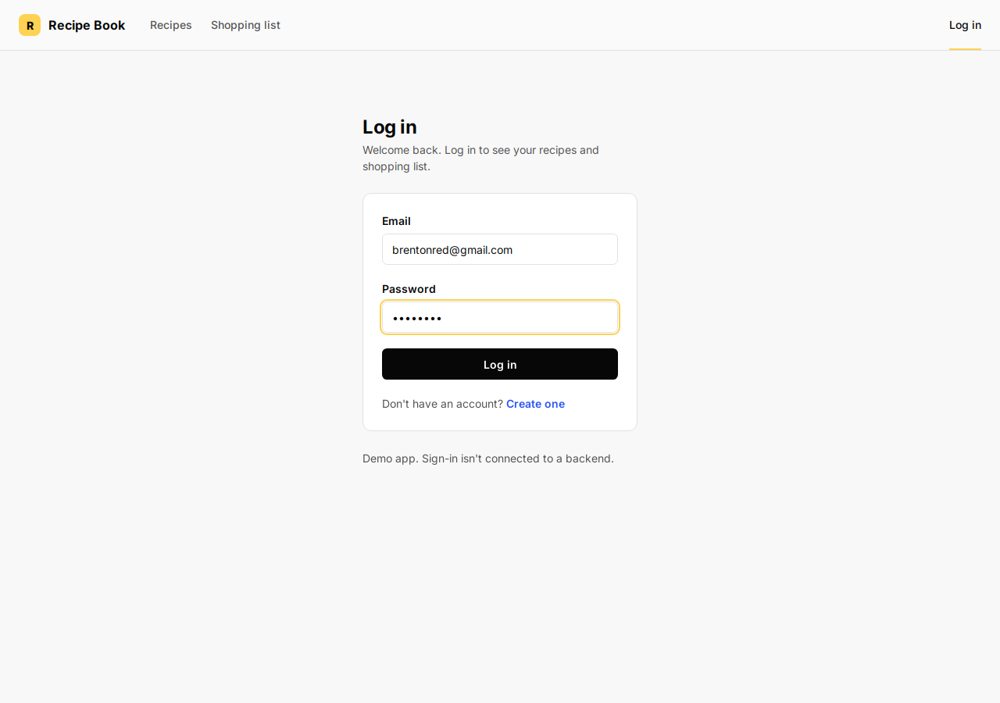
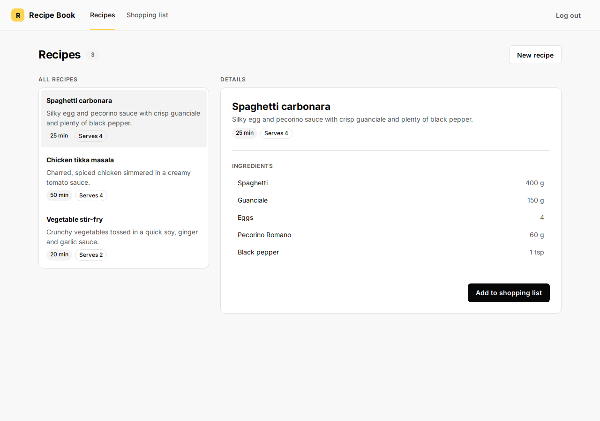
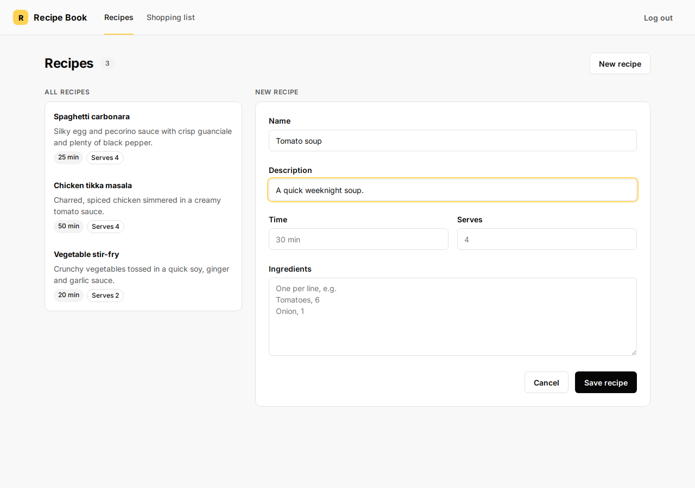
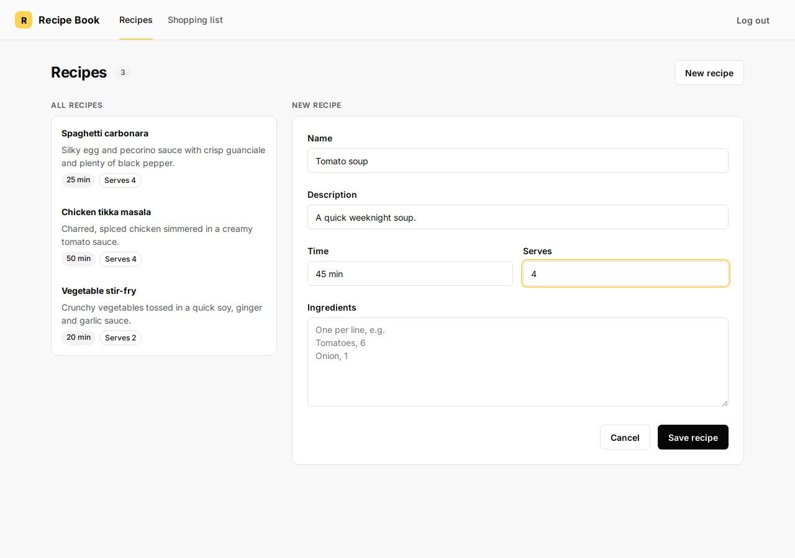
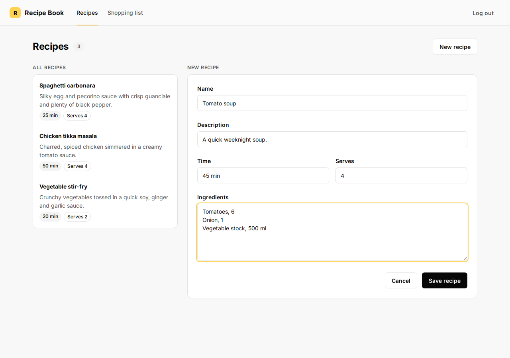
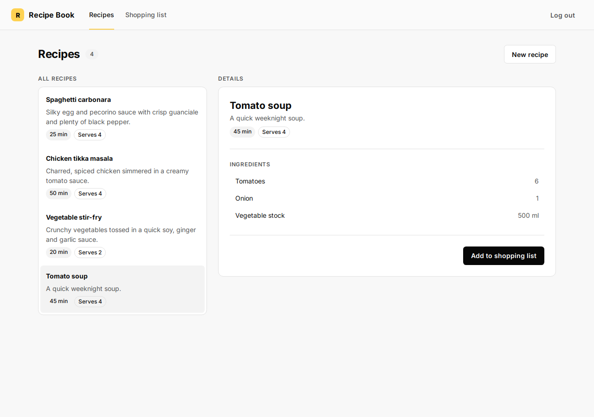

# Add a new recipe

Use this to save a **new recipe** in the Recipe Book. You type the recipe details yourself.

**Demo URL:** https://demo-angular-22-wgdt.free.ccpve.co.za

**Important:** New recipes stay until you refresh the page. After a full page reload, only the built-in sample recipes remain.

## Steps

### Step 1 — Open Recipe Book and sign in

Open the demo URL above. You should see the **Log in** page.

1. Click in the **Email** box. Type any email (the demo does not check it).
2. Click in the **Password** box. Type any password.
3. Click the blue **Log in** link **inside the white card** (not the small **Log in** tab in the top-right header).

You should land on the **Recipes** page.



### Step 2 — Start a new recipe

On the **Recipes** page, click the **New recipe** button at the top right (next to the recipe count).

The right panel changes from **Details** to a form labeled **New recipe**.



### Step 3 — Enter name and description

1. Click **Name** and type a short title, for example `Tomato soup`.
2. Click **Description** and type one sentence about the dish.



### Step 4 — Enter time and serves

1. Click **Time** and type how long it takes, for example `45 min`.
2. Click **Serves** and type how many people it feeds, for example `4`.

If you leave these empty, the app still saves the recipe (time shows **—** and serves default to **Serves 1**).



### Step 5 — Enter ingredients (one line each)

Click the large **Ingredients** box. Type **one ingredient per line** in this format:

`ingredient name, amount`

Example (three lines):

```text
Tomatoes, 6
Onion, 1
Vegetable stock, 500 ml
```

- Put a **comma** between the name and the amount.
- If a line has **no comma**, the amount is treated as **1**.



### Step 6 — Save the recipe

Click the blue **Save recipe** button at the bottom of the form.

**Success looks like this:**

- The form closes.
- Your recipe appears in **All recipes** on the left (usually selected).
- The **Details** panel on the right shows your name, description, time, serves, and ingredient list.



To discard the form without saving, click **Cancel** instead of **Save recipe**.