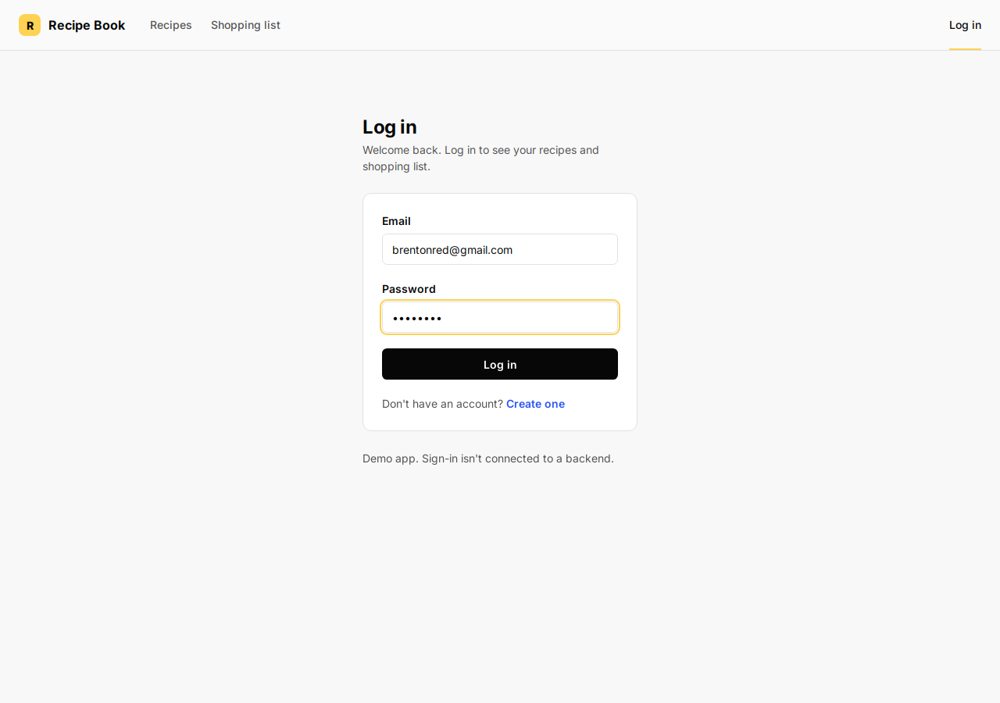
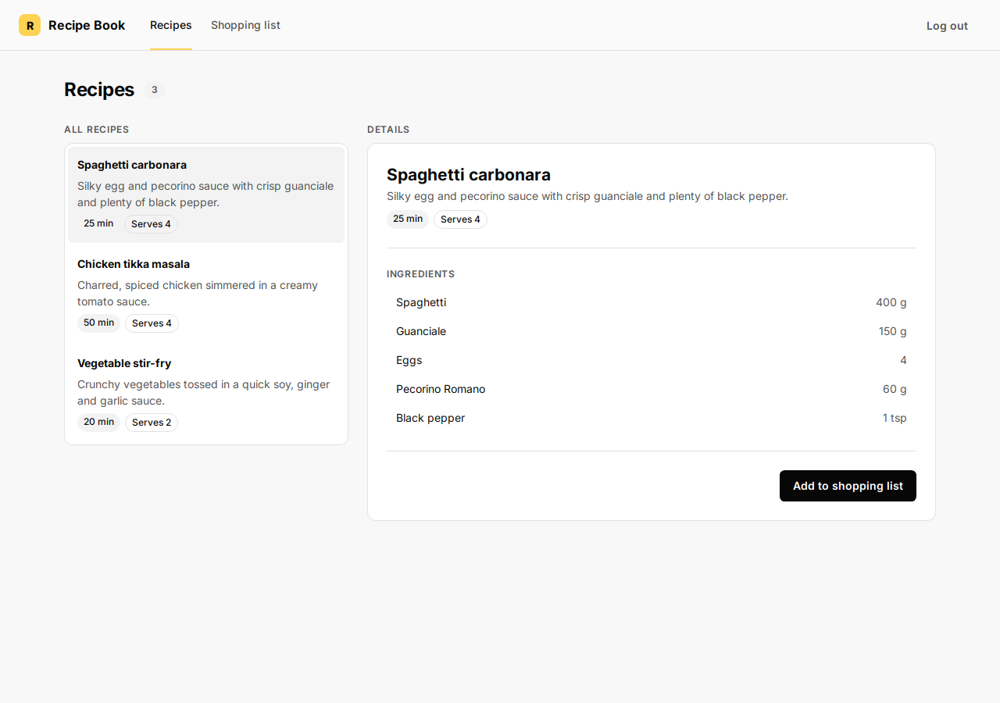
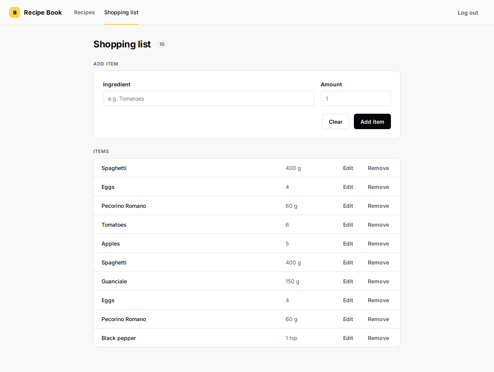

# Add a recipe to your shopping list

Add **every ingredient** from a recipe to **Items** in one click.

**Demo URL:** https://demo-angular-22-wgdt.free.ccpve.co.za

## Steps

### Step 1 — Sign in

1. Open the demo URL. You see the **Log in** page.
2. Type any **Email** and **Password** (the demo does not check them).
3. Click the blue **Log in** link **inside the white card** (not the small **Log in** tab in the top-right header).

You land on **Recipes**.

### Step 2 — Choose a recipe

Under **All recipes**, click the recipe you want, for example **Spaghetti carbonara**.

The **Details** panel on the right updates.

### Step 3 — Check ingredients

Under **Details**, read the **Ingredients** list to confirm what will be added.

### Step 4 — Add to shopping list

Click the blue **Add to shopping list** button.

The app opens **Shopping list**. The recipe ingredients appear in **Items** (along with any items that were already on the list).

