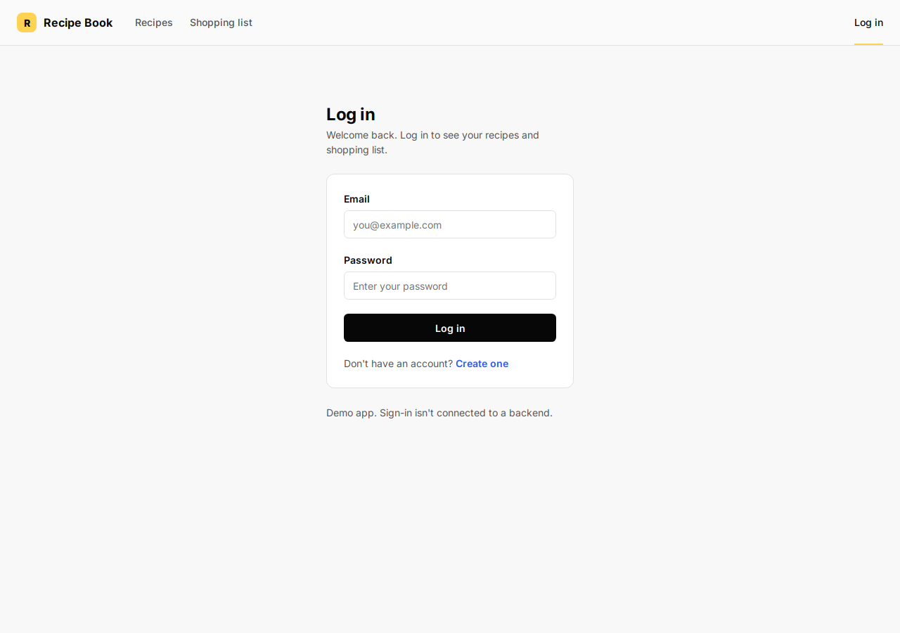
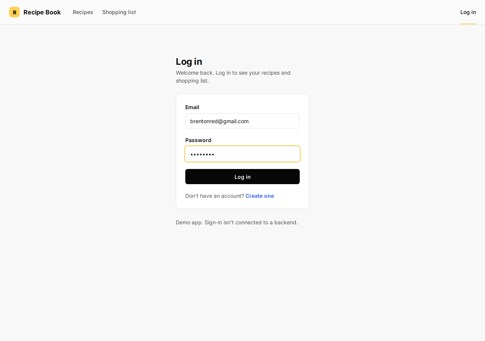
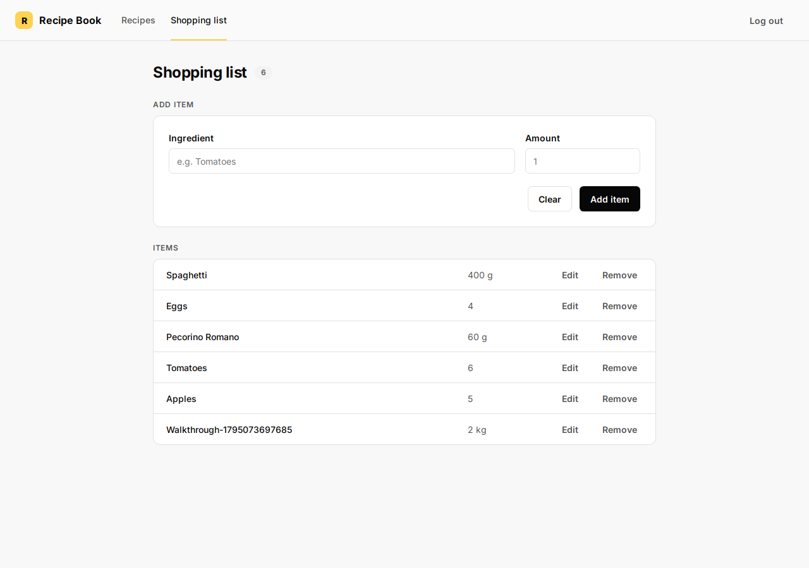

# Add an item to your shopping list

Use this when you want **one** item on the list. For every ingredient in a recipe at once, see [Add a recipe to your shopping list](add-recipe-to-shopping-list.md).

**Before you start:** open [Recipe Book](https://demo-angular-22-wgdt.free.ccpve.co.za). The first page is **Log in**.

## Step 1 — Sign in

1. Type your **Email** in the **Email** box.
2. Type your **Password** in the **Password** box.
3. Click the blue **Log in** link **in the white card** (under the password field).  
   Do **not** click **Log in** in the top header — that only returns you to this page.

The **Recipes** page opens.

## Step 2 — Open Shopping list

1. At the top, click the **Shopping list** tab (next to **Recipes**).

You see **Add item** and **Items**. The list may already show ingredients from the demo — that is normal.

## Step 3 — Enter the new item

1. In **Add item**, type the ingredient name in **Ingredient** (for example `Butter`).
2. Type how much you need in **Amount** (for example `200 g`). If you leave **Amount** empty, the app uses `1`.

## Step 4 — Save the item

1. Click **Add item** (blue button on the right).
2. Check **Items**: your ingredient appears in the list with its amount.
3. The **Ingredient** and **Amount** boxes clear so you can add another item.

**Tip:** **Clear** empties the form without adding anything.