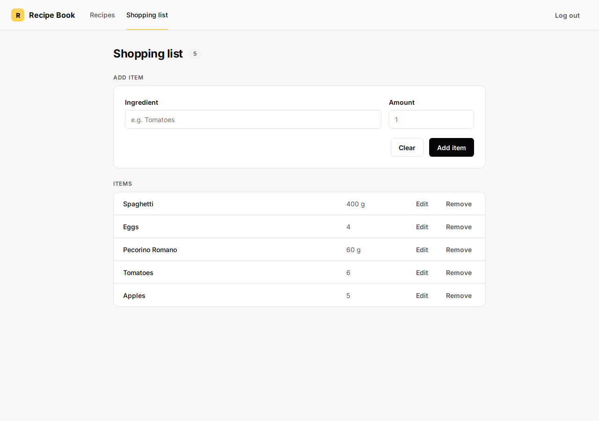
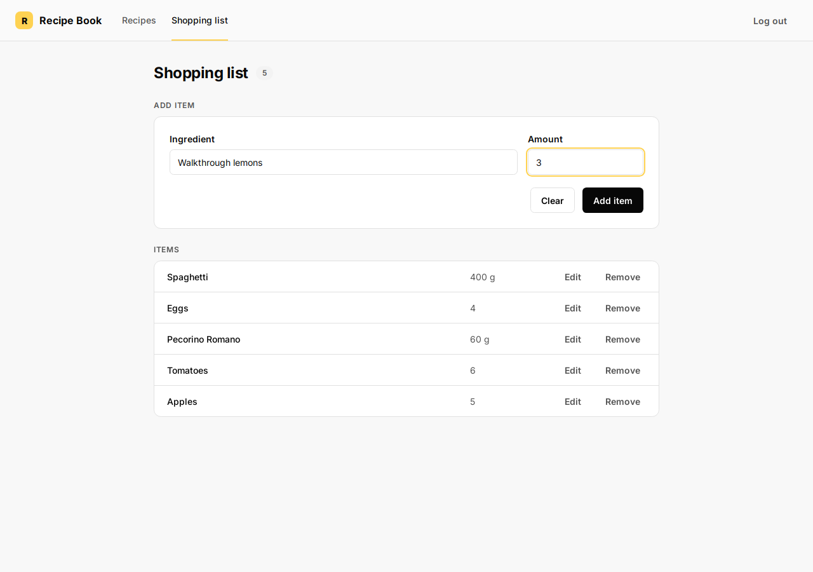
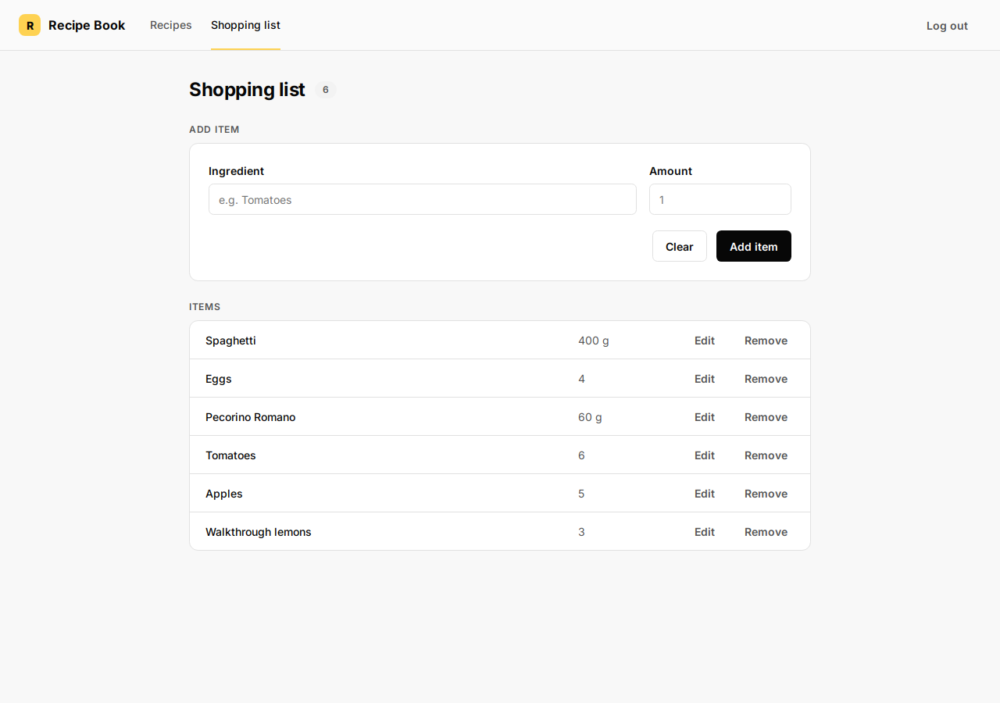

# Add an item to your shopping list

Use this when you want **one** ingredient on your list (not a whole recipe).

## Before you start

- Open the Recipe Book demo in your browser.
- You need any email and password. The demo does not check them.

## Steps

### 1. Log in

1. On the **Log in** page, click in the **Email** box and type your email.
2. Click in the **Password** box and type your password.
3. Click the blue **Log in** link in the white card (not the **Log in** tab in the top bar).

You should see the **Recipes** page.

### 2. Open the Shopping list page

1. In the top bar, click **Shopping list** (between **Recipes** and **Log out**).

You should see the heading **Shopping list** and the **Add item** section.

**Note:** The demo may already show items under **Items**. That is normal. You can still add more.

### 3. Fill in the new item

1. In **Ingredient**, type what you are buying (for example `Tomatoes`).
2. In **Amount**, type how much you need (for example `6`).
3. Leave **Amount** blank only if you want the default amount `1`.

### 4. Add the item

1. Click the blue **Add item** button on the right.

The new row appears under **Items**. The **Ingredient** and **Amount** fields clear so you can add another item.

## If something looks wrong

| What you see | What to do |
|---|---|
| Nothing happens when you click **Add item** | **Ingredient** cannot be empty. Type a name, then click **Add item** again. |
| You are still on **Log in** | Click the **Log in** link inside the form on the card, not only the header tab. |
| Your list disappeared after refresh | The demo stores the list in memory only. Refreshing the page resets the list. |