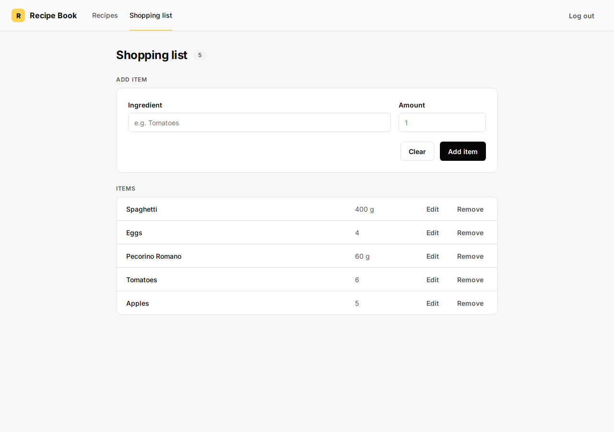
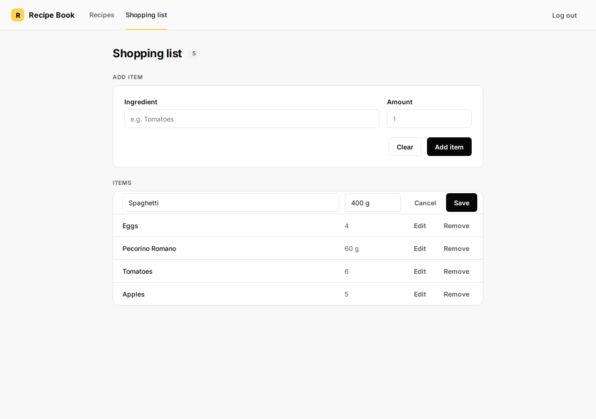
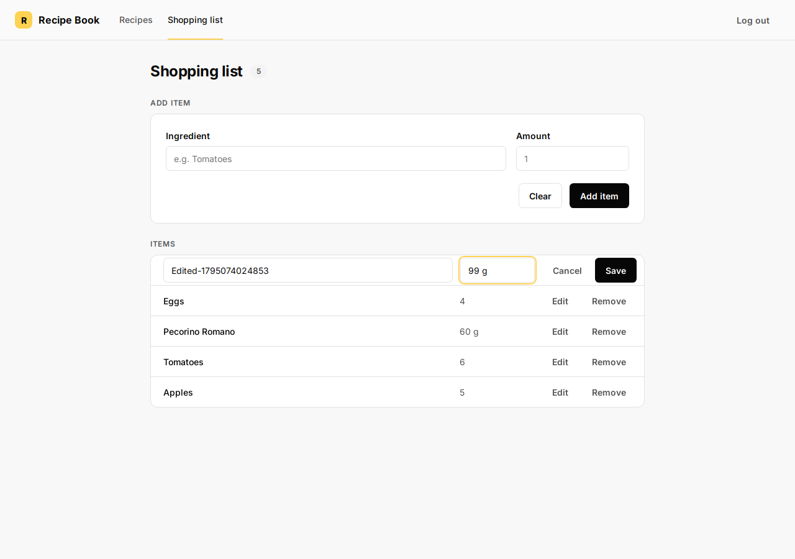

# Edit a shopping list item

Use **Edit** when a row is on the list but the **name** or **amount** is wrong. To add a brand-new row, use [Add an item to your shopping list](add-to-shopping-list.md). To delete a row, use [Remove an item from your shopping list](remove-from-shopping-list.md).

**Before you start:** open [Recipe Book](https://demo-angular-22-wgdt.free.ccpve.co.za) and sign in (same as step 1 in the add-item guide).

## Step 1 — Sign in

1. Enter **Email** and **Password**.
2. Click the blue **Log in** link in the form card (not the header **Log in** tab).
3. The **Recipes** page opens.

## Step 2 — Open Shopping list

1. Click the **Shopping list** tab at the top.

Each row in **Items** shows the ingredient, amount, **Edit**, and **Remove**.

## Step 3 — Start editing

1. On the row you want to change, click **Edit**.
2. The row turns into two fields: **Ingredient name** and **Amount**, plus **Cancel** and **Save**.

3. Change the text in one or both fields.

If you clear the ingredient name completely, **Save** will not apply — keep at least one character in the name.

## Step 4 — Save or cancel

1. Click **Save** to keep your changes. The row shows the new name and amount as normal text again.
2. Or click **Cancel** to abandon changes and return to the old name and amount.

Only one row can be in edit mode at a time. Starting **Edit** on another row, or clicking **Remove**, closes the current edit without saving unless you clicked **Save** first.