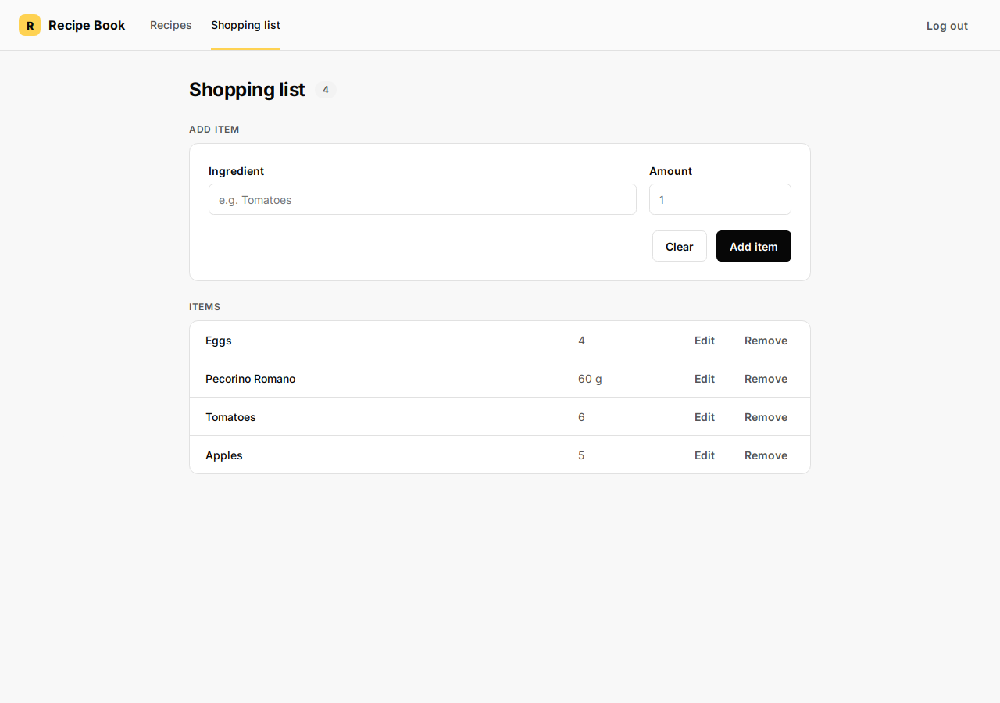

# Remove an item from your shopping list

**Before you start:** open [Recipe Book](https://demo-angular-22-wgdt.free.ccpve.co.za) and sign in (same as step 1 in [Add an item to your shopping list](add-to-shopping-list.md)).

## Step 1 — Sign in

1. Enter **Email** and **Password**.
2. Click the blue **Log in** link in the form card (not the header **Log in** tab).
3. The **Recipes** page opens.

## Step 2 — Open Shopping list

1. Click the **Shopping list** tab at the top.

Under **Items**, each row shows an ingredient, its amount, and a **Remove** button on the right.

## Step 3 — Remove one item

1. Find the row for the ingredient you want to delete.
2. On that row, click **Remove**.

## Step 4 — Confirm it is gone

1. That row disappears from **Items**.
2. The number in the chip next to **Shopping list** goes down by one.

If **Items** shows “Your shopping list is empty.”, there is nothing left to remove.