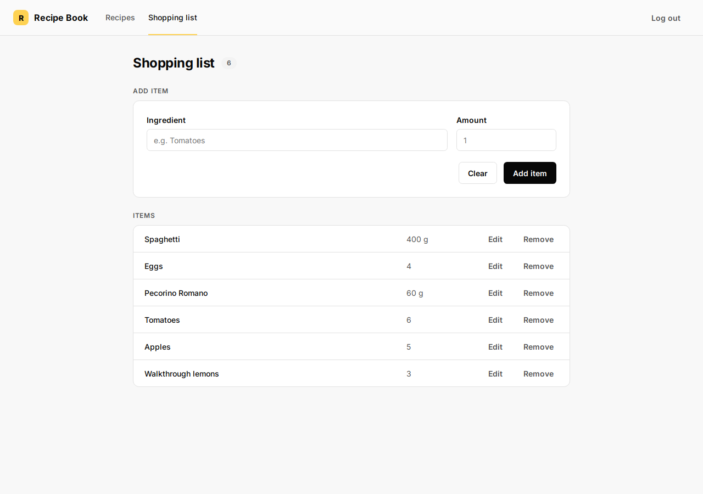
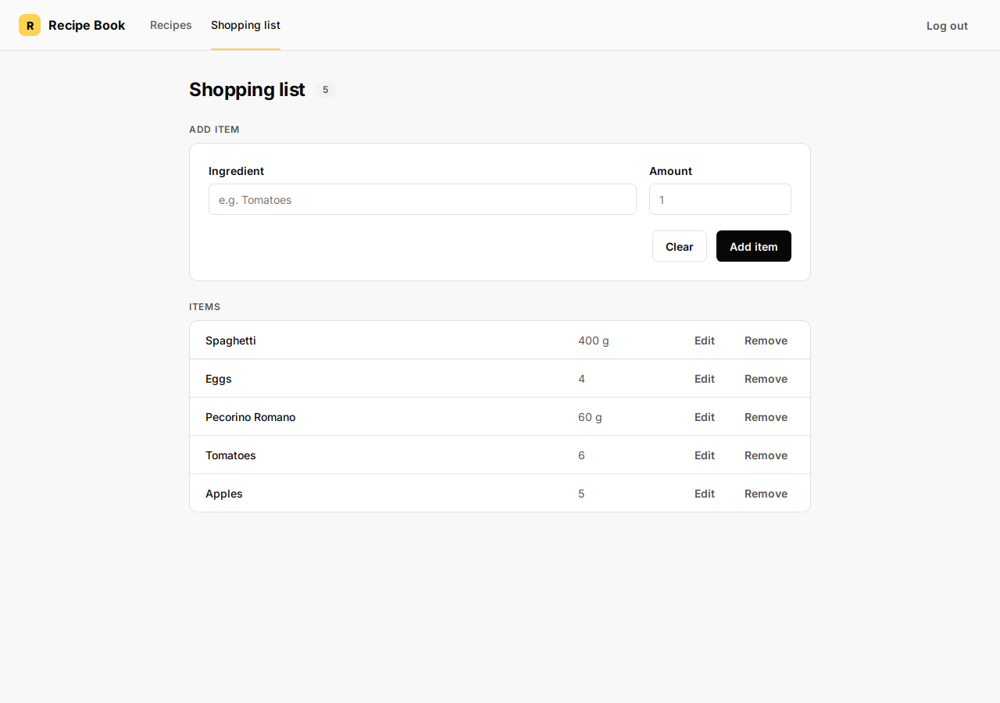

# Remove an item from your shopping list

Use this when you no longer need an ingredient on your list.

## Before you start

- You must be logged in (see the **Log out** link in the top bar).
- Open the **Shopping list** page from the top bar.

## Steps

### 1. Find the item

1. Click **Shopping list** in the top bar if you are not there already.
2. Scroll to the **Items** section.
3. Find the row with the ingredient you want to remove.

### 2. Remove it

1. On that row, click **Remove** on the right.

The row disappears immediately. The number in the chip next to **Shopping list** goes down by one.

## If something looks wrong

| What you see | What to do |
|---|---|
| **Remove** does nothing | Click **Remove** on the same row as the ingredient name, not on another row. |
| The whole list is empty | If every item is gone, you see *Your shopping list is empty.* Add items with [Add an item to your shopping list](add-to-shopping-list.md). |
| Items came back after refresh | The demo resets the list on refresh. Removal only lasts until you reload the page. |